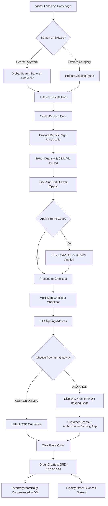
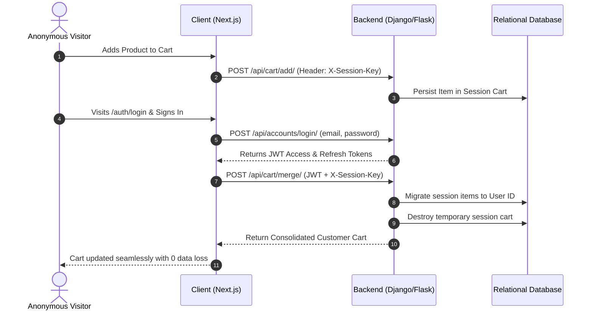
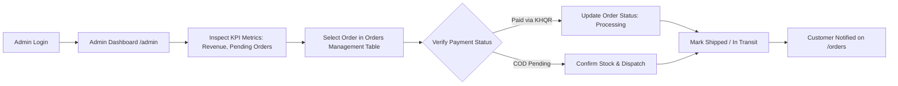
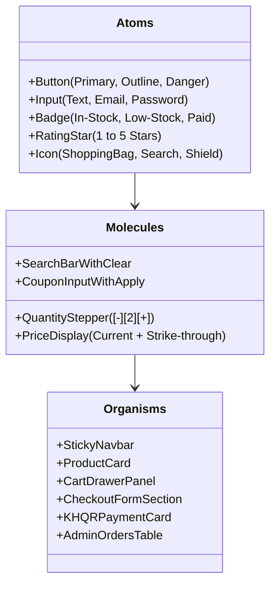

# ShopEase — Complete Figma UX/UI Design Blueprint & Specification

**Project:** ShopEase Full-Stack E-Commerce Platform  
**Target Resolution:** Desktop (1440 × 1024 px) & Mobile (375 × 812 px)  
**Design Tokens Version:** 2.0.0 (WCAG 2.1 Level AA Compliant)  
**Design Tool Compatibility:** Figma, FigJam, Tokens Studio  

---

## 1. User Flows & Screen Lists

### 1.1 Complete Screen List & Hierarchy

| No. | Screen Name | Route | Role / Access | Key UI Responsibilities |
|:---|:---|:---|:---|:---|
| **01** | **Storefront Home** | `/` | Public (All) | Hero value proposition, category navigation, trending products carousel, trust badges, newsletter sign-up. |
| **02** | **Product Catalog** | `/shop` | Public (All) | Global live search, multi-parametric filters (categories, price range, in-stock), sorting options, responsive card grid. |
| **03** | **Product Details** | `/product/[id]` | Public (All) | High-resolution media zoom, thumbnail gallery, verified 5-star ratings, stock counter, quantity stepper, add-to-cart CTA. |
| **04** | **Slide-Out Cart Drawer** | *Overlay* | Public (All) | Cart item preview, live quantity adjustment, coupon engine (`SAVE15`), free shipping threshold counter ($50). |
| **05** | **Shopping Cart Page** | `/cart` | Public (All) | Full-page cart overview, order cost calculation, coupon validation, empty state handler. |
| **06** | **Multi-Step Checkout** | `/checkout` | Public (Guest & Member) | Recipient address form, delivery instructions, payment selector (ABA KHQR, COD, Credit Card), order summary. |
| **07** | **ABA KHQR Payment Modal** | *Modal Dialog* | Public (All) | High-contrast dynamic Bakong KHQR code display, amount confirmation, real-time transaction listener. |
| **08** | **Order Confirmation** | `/orders/[id]` | Public / Customer | Order tracking reference (`ORD-XXXXXXXX`), fulfillment status timeline, invoice print summary. |
| **09** | **User Sign In** | `/auth/login` | Unauthenticated | Email/password login, demo quick-fill credentials, session key cart merge, password recovery link. |
| **10** | **User Registration** | `/auth/register` | Unauthenticated | Account registration form, password strength meter, terms acceptance. |
| **11** | **Customer Order History** | `/orders` | Authenticated Customer | Past orders list, real-time status badges (`Pending`, `Processing`, `Delivered`), order receipt download. |
| **12** | **Admin Operations Hub** | `/admin` | Staff / Admin | Store KPI metrics (Revenue, Orders, Products, Low Stock alerts), real-time order status management, inventory controls. |
| **13** | **Design System Showcase** | `/design-system` | Public / Evaluator | Interactive design token preview, component library playground, wireframe architectural blueprints. |

---

### 1.2 User Journey Flows

#### Flow A: Guest to Checkout Journey (Discovery to Conversion)


#### Flow B: Guest-to-Customer Cart Synchronization


#### Flow C: Store Administrator Order Fulfillment Flow


---

## 2. Visual Wireframes & Screen Blueprints

### Wireframe 01: Storefront Homepage (`/`) — Desktop (1440px)
```text
+-----------------------------------------------------------------------------------------------------------------+
| [!] Special Promo: Use code WELCOME10 for 10% off • Free Express Delivery Over $50 (USD)        [Support | USD] |
+-----------------------------------------------------------------------------------------------------------------+
|  [Logo: ShopEase]      [ Search premium electronics, apparel, lifestyle... [X] ]   [Home] [Shop] [UI/UX] [Cart(2)] [User] |
+-----------------------------------------------------------------------------------------------------------------+
|                                                                                                                 |
|  [✨ NEW ARRIVAL 2026 COLLECTION LIVE NOW]                                                                      |
|  Crafted for Quality.                                                 +--------------------------------------+  |
|  Designed for Life.                                                   |  [ Featured Hero Product Media ]     |  |
|                                                                       |       Sony WH-1000XM5 ANC            |  |
|  Discover world-class electronics, trending apparel,                  |       ★★★★★ (4.8 / 5.0)              |  |
|  and artisanal home essentials with guaranteed authenticity.          |       $299.00  ($399.00)             |  |
|                                                                       +--------------------------------------+  |
|  [ Explore Catalog -> ]   [ ⚡ Electronics ]                                                                    |
|                                                                                                                 |
+-----------------------------------------------------------------------------------------------------------------+
|  [🚚 Free Delivery Over $50]  |  [🛡️ 100% Encrypted Checkout]  |  [🔄 30-Day Free Returns]  |  [🎧 24/7 Support]  |
+-----------------------------------------------------------------------------------------------------------------+
|  POPULAR CATEGORIES                                                                                             |
|  [ 📱 Electronics (4) ]     [ 👕 Fashion (2) ]     [ 🏠 Home & Kitchen (1) ]     [ ⚽ Sports (1) ]              |
+-----------------------------------------------------------------------------------------------------------------+
|  FEATURED PRODUCTS                                                                 [ View All 8 Products -> ]   |
|  +--------------------+  +--------------------+  +--------------------+  +--------------------+                 |
|  | [Product Image]    |  | [Product Image]    |  | [Product Image]    |  | [Product Image]    |                 |
|  | -25% OFF           |  | NEW ARRIVAL        |  |                    |  |                    |                 |
|  | Sony WH-1000XM5    |  | Apple Watch Ultra2 |  | Nike Air Max Pulse |  | Dell XPS 15 Laptop |                 |
|  | ★★★★★ (4.8)        |  | ★★★★★ (4.9)        |  | ★★★★★ (4.7)        |  | ★★★★★ (4.8)        |                 |
|  | $299.00  $399.00   |  | $799.00            |  | $150.00            |  | $1,499.00          |                 |
|  | [ Add To Cart ]    |  | [ Add To Cart ]    |  | [ Add To Cart ]    |  | [ Add To Cart ]    |                 |
|  +--------------------+  +--------------------+  +--------------------+  +--------------------+                 |
+-----------------------------------------------------------------------------------------------------------------+
|  FOOTER: Brand Bio | Quick Links | Customer Care | Demo Credentials (Admin/Customer) | Copyright 2026           |
+-----------------------------------------------------------------------------------------------------------------+
```

### Wireframe 02: Product Catalog & Multi-Parametric Filter (`/shop`)
```text
+-----------------------------------------------------------------------------------------------------------------+
| HEADER NAVIGATION (Sticky, 80px)                                                                                |
+-----------------------------------------------------------------------------------------------------------------+
| Home / Shop Catalog                                                                                             |
|                                                                                                                 |
| +-----------------------------+  +----------------------------------------------------------------------------+ |
| | FILTERS                     |  | Showing 8 products found                        [ Sort: Newest Arrivals v] | |
| |-----------------------------|  |----------------------------------------------------------------------------| |
| | Categories:                 |  | +--------------------+ +--------------------+ +--------------------+       | |
| | [x] All Products (8)        |  | | [Card 1]           | | [Card 2]           | | [Card 3]           |       | |
| | [ ] Electronics (4)         |  | | Sony WH-1000XM5    | | Apple Watch Ultra  | | Nike Air Max Pulse |       | |
| | [ ] Fashion (2)             |  | | $299.00  ★4.8      | | $799.00  ★4.9      | | $150.00  ★4.7      |       | |
| | [ ] Home & Kitchen (1)      |  | | [ Add To Cart ]    | | [ Add To Cart ]    | | [ Add To Cart ]    |       | |
| |                             |  | +--------------------+ +--------------------+ +--------------------+       | |
| | Price Range:                |  |                                                                            | |
| | Min: [$ 0   ] Max: [$ 2000] |  | +--------------------+ +--------------------+ +--------------------+       | |
| | [=======o-------------]     |  | | [Card 4]           | | [Card 5]           | | [Card 6]           |       | |
| |                             |  | | Dell XPS 15 Laptop | | Espresso Machine   | | Nike Pro Dri-FIT   |       | |
| | Stock Status:               |  | | $1,499.00 ★4.8     | | $599.00 ★4.6       | | $45.00 ★4.5        |       | |
| | [x] In-Stock Items Only     |  | | [ Add To Cart ]    | | [ Add To Cart ]    | | [ Add To Cart ]    |       | |
| |                             |  | +--------------------+ +--------------------+ +--------------------+       | |
| | [ Reset All Filters ]       |  +----------------------------------------------------------------------------+ |
| +-----------------------------+                                                                                 |
+-----------------------------------------------------------------------------------------------------------------+
```

### Wireframe 03: Slide-Out Cart Drawer (`CartDrawer.tsx` Overlay)
```text
+---------------------------------------------------------------------------------------+=========================+
| (Darkened & Blurred Backdrop: opacity 65%, blur 8px)                                   | SHOPPING CART (2)   [X] |
|                                                                                       |-------------------------|
|                                                                                       | [🎉 Free Delivery       |
|                                                                                       |    Threshold Reached!]  |
|                                                                                       |-------------------------|
|                                                                                       | [Thumb] Sony WH-1000XM5 |
|                                                                                       |         $299.00 x 2     |
|                                                                                       |         $598.00         |
|                                                                                       |         [-] [ 2 ] [+] [🗑|
|                                                                                       |-------------------------|
|                                                                                       | Promo Voucher:          |
|                                                                                       | [ SAVE15      ] [Apply] |
|                                                                                       | ✓ SAVE15 Applied (-$15) |
|                                                                                       |-------------------------|
|                                                                                       | Subtotal:       $598.00 |
|                                                                                       | Discount:       -$15.00 |
|                                                                                       | Delivery:          FREE |
|                                                                                       | Total:          $583.00 |
|                                                                                       |-------------------------|
|                                                                                       | [ PROCEED TO CHECKOUT ] |
+---------------------------------------------------------------------------------------+=========================+
```

### Wireframe 04: Multi-Step Checkout & Localized Payment (`/checkout`)
```text
+-----------------------------------------------------------------------------------------------------------------+
| HEADER: ShopEase Checkout                                                Step: [1. Cart] -> [*2. Payment] -> [3] |
+-----------------------------------------------------------------------------------------------------------------+
|                                                                                                                 |
| +-----------------------------------------------------------+  +----------------------------------------------+ |
| | 1. SHIPPING & DELIVERY ADDRESS                            |  | ORDER SUMMARY                                | |
| | Full Name:     [ Sokha Meas                             ] |  |----------------------------------------------| |
| | Phone:         [ 012 345 678                            ] |  | Sony WH-1000XM5 Wireless (x2)       $598.00  | |
| | Address:       [ Street 271, Sangkat Boeung Tumpun      ] |  | Subtotal:                           $598.00  | |
| | City/Province: [ Phnom Penh                           v ] |  | Promo Discount (SAVE15):            -$15.00  | |
| |                                                           |  | Delivery:                              FREE  | |
| | 2. SELECT PAYMENT METHOD                                  |  |----------------------------------------------| |
| | +-------------------------------------------------------+ |  | TOTAL DUE:                          $583.00  | |
| | | (*) [🏦 ABA KHQR / Mobile Banking (Scan to Pay)]     | |  |                                              | |
| | |     Instant zero-fee scan via Bakong, ABA, ACLEDA     | |  | [ PLACE ORDER (ORD-XXXXXXXX) ]               | |
| | +-------------------------------------------------------+ |  | 🔒 256-bit TLS Encrypted Transaction         | |
| | | ( ) [💵 Cash on Delivery (COD)]                       | |  +----------------------------------------------+ |
| | +-------------------------------------------------------+ |                                                   |
| |                                                           |                                                   |
| | [ DYNAMIC BAKONG KHQR CODE SIMULATOR ]                    |                                                   |
| | +--------------------+  Total: $583.00 USD                |                                                   |
| | | [QR Code Graphic]  |  1. Open Bakong or ABA Mobile      |                                                   |
| | |     (160x160)      |  2. Scan the dynamic code          |                                                   |
| | +--------------------+  3. Order verifies automatically   |                                                   |
| +-----------------------------------------------------------+                                                   |
+-----------------------------------------------------------------------------------------------------------------+
```

### Wireframe 05: Store Operations Admin Dashboard (`/admin`)
```text
+-----------------------------------------------------------------------------------------------------------------+
| [Logo] ShopEase [ADMIN] | Dashboard Overview                             Status: [🟢 Live 24/7] | Admin User (A)|
+-------------------+---------------------------------------------------------------------------------------------+
| SIDEBAR           | KPI PERFORMANCE METRICS                                                                     |
| [📊 Overview    ] | +-------------------+ +-------------------+ +-------------------+ +-------------------+     |
| [📦 Products    ] | | TOTAL REVENUE     | | TOTAL ORDERS      | | ACTIVE PRODUCTS   | | LOW STOCK ALERTS  |     |
| [📑 Orders      ] | | $12,480.00        | | 142               | | 8 Items           | | 2 Items           |     |
| [👥 Customers   ] | | ↑ 18.2% this mo   | | 12 need action    | | 100% active       | | Stock < 10 units  |     |
| [🎟️ Coupons     ] | +-------------------+ +-------------------+ +-------------------+ +-------------------+     |
| [⚙️ Settings    ] |                                                                                             |
|                   | RECENT ORDERS MANAGEMENT TABLE                                                              |
|                   | +-----------------------------------------------------------------------------------------+ |
|                   | | ORDER REF     | CUSTOMER     | PAYMENT METHOD | TOTAL    | STATUS       | ACTION        | |
|                   | |---------------|--------------|----------------|----------|--------------|---------------| |
|                   | | #ORD-B45A342E | Sokha Meas   | Paid (KHQR)    | $583.00  | [Processing] | [ Dispatch ->]| |
|                   | | #ORD-7C189F2A | Bopha Chan   | Pending (COD)  | $150.00  | [Pending   ] | [ Review    ] | |
|                   | | #ORD-91D0E442 | Dara Som     | Paid (Card)    | $299.00  | [Delivered ] | [ Details   ] | |
|                   | +-----------------------------------------------------------------------------------------+ |
+-------------------+---------------------------------------------------------------------------------------------+
```

---

## 3. The Design System Architecture

### 3.1 Color Palette & Semantic Meaning

```
Brand Primary:    #4f46e5 (Indigo 600)  ■  #6366f1 (Indigo 500)  ■  #eef2ff (Indigo 50)  ■
Secondary Accent: #7c3aed (Violet 600)  ■  #0ea5e9 (Sky 500)     ■
Semantic States:  #10b981 (Success)     ■  #f59e0b (Warning)     ■  #f43f5e (Danger)     ■
Neutrals (Dark):  #020617 (Slate 950)   ■  #0f172a (Slate 900)   ■  #1e293b (Slate 800)  ■
Neutrals (Light): #e2e8f0 (Slate 200)   ■  #f1f5f9 (Slate 100)   ■  #ffffff (White)      ■
```

| Token Identifier | Hex Code | Contrast (vs White) | Design System Usage |
|:---|:---|:---|:---|
| `color-brand-primary` | `#4f46e5` | **8.1 : 1** (AAA) | Primary action buttons, active navigation indicator, checkout submit. |
| `color-brand-hover` | `#6366f1` | **6.4 : 1** (AA) | Button hover state, focus rings, interactive card accents. |
| `color-brand-surface` | `#eef2ff` | 1.1 : 1 | Soft container backgrounds, active filter pills, table row highlight. |
| `color-accent-violet` | `#7c3aed` | **9.2 : 1** (AAA) | Hero gradient text, category banner accents. |
| `color-semantic-success` | `#10b981` | **4.6 : 1** (AA) | `In Stock` badge, free shipping unlocked, order completed. |
| `color-semantic-warning` | `#f59e0b` | **4.5 : 1** (AA) | `Low Stock` alert (&lt; 10 items), pending COD verification. |
| `color-semantic-danger` | `#f43f5e` | **5.3 : 1** (AA) | Delete from cart button, invalid coupon error toast, out-of-stock. |
| `color-neutral-darkest` | `#020617` | **19.8 : 1** (AAA) | Top announcement bar, footer background, terminal dark surface. |
| `color-neutral-surface` | `#0f172a` | **18.2 : 1** (AAA) | Dark card container backgrounds, modal body surfaces. |
| `color-neutral-border` | `#1e293b` | 2.1 : 1 | Sub-surface dividers, stroke borders on dark cards. |
| `color-neutral-light` | `#f1f5f9` | 1.2 : 1 | Light theme input surfaces, quantity stepper container. |

---

### 3.2 Typography Scale (Inter Typeface)

```
Scale Name       Size / Line-Height    Weight        Figma Token Name       Usage
-------------------------------------------------------------------------------------------------
Display 1        48px / 56px (1.16)    Black (900)   Typography/Display-1   Homepage Hero headline
Heading 1        32px / 40px (1.25)    Bold (800)    Typography/H1          Page titles, catalog header
Heading 2        24px / 32px (1.33)    Bold (700)    Typography/H2          Section titles, cart subtotal
Heading 3        20px / 28px (1.40)    Bold (700)    Typography/H3          Product card titles, modal title
Body Regular     14px / 22px (1.57)    Regular (400) Typography/Body-Reg    Descriptions, specs, reviews
Body Bold        14px / 22px (1.57)    Bold (700)    Typography/Body-Bold   Price numbers, table headers
Micro / Caption  12px / 16px (1.33)    SemiBold(600) Typography/Caption     Status pills, SKU, stock count
Code / Mono      13px / 18px (1.38)    Bold (700)    Typography/Mono        Order numbers (ORD-...), coupons
```

---

### 3.3 Spacing Scale & 8pt Grid System

Every layout, gap, padding, and margin adheres to an **8-point geometric scale**:

| Token | Pixels | Rem Equiv | Common Application |
|:---|:---|:---|:---|
| `space-1` | **4px** | `0.25rem` | Icon-to-label gaps, badge internal padding, divider thickness. |
| `space-2` | **8px** | `0.5rem` | Button icon gaps, stepper button margins, chip separation. |
| `space-3` | **12px** | `0.75rem` | Input field vertical padding, tag margins. |
| `space-4` | **16px** | `1.0rem` | Card internal padding, form field vertical gaps. |
| `space-6` | **24px** | `1.5rem` | Grid gutters, drawer section separators, navbar horizontal padding. |
| `space-8` | **32px** | `2.0rem` | Section gaps, modal padding, column spacing. |
| `space-12` | **48px** | `3.0rem` | Hero bottom spacing, touch target dimensions for mobile CTAs. |
| `space-16` | **64px** | `4.0rem` | Page section margins on Desktop. |

---

### 3.4 Atomic Components Matrix



---

## 4. Figma Setup Tips & Best Practices

### 4.1 Frame & Page Hierarchy

To build a professional, portfolio-grade Figma file:

1. **Organize Pages Clearly:**
   - `01 🎨 Foundations`: Color Variables, Typography Styles, Spacing Tokens, Effect Styles (Elevation).
   - `02 🧩 Component Library`: Atoms (Buttons, Inputs, Badges) & Organisms (Navbar, Cards, Modals).
   - `03 🖥️ Desktop Screens (1440px)`: Home, Catalog, Details, Cart Drawer, Checkout, Admin.
   - `04 📱 Mobile Screens (375px)`: Responsive mobile layouts for all views.
   - `05 ⚡ Interactive Prototypes`: Wired screens with transitions and smart animations.

2. **Standard Frame Dimensions:**
   - **Desktop:** `1440 × 1024 px` (Figma preset: *Desktop*).
   - **Mobile:** `375 × 812 px` (Figma preset: *iPhone 13/14 mini*) or `393 × 852 px` (*iPhone 15 Pro*).

3. **Layout Grid Setup:**
   - **Desktop Grid:** 12 Columns, Margin `80px`, Gutter `24px` (Width: Stretch).
   - **Mobile Grid:** 4 Columns, Margin `16px`, Gutter `12px` (Width: Stretch).

---

### 4.2 Auto Layout Mastery Rules

Figma Auto Layout (`Shift + A`) is essential to make components fluid and responsive:

*   **Rule 1: Never Draw Static Rectangles for Buttons or Cards.**
    - For a Button: Create a Text layer ("Add To Cart"), select it, press `Shift + A`.
    - Set Horizontal Padding to `24px`, Vertical Padding to `14px`, Corner Radius to `14px`.
    - Fill with `#4f46e5` (Brand Primary). Resizing: `Horizontal = Hug contents`, `Vertical = Hug contents`.
*   **Rule 2: Master "Hug" vs "Fill Container".**
    - **Cards in a Grid:** The parent grid container has Auto Layout (Horizontal, Wrap enabled). Each Product Card is set to `Horizontal = Fill container` or `Fixed 295px`.
    - **Text in a Card:** Product title and description must be set to `Horizontal = Fill container` so that long text wraps naturally without overflowing.
*   **Rule 3: Absolute Positioning for Notification Badges.**
    - Place the Cart Icon inside a Frame. Add a Badge Frame (`18x18px`, red/indigo fill with number "2").
    - In the right-hand Inspector, click the **Absolute Position** icon (top right corner of the Frame properties). Position it at `-4px top`, `-4px right`.

---

### 4.3 Components & Variants Architecture

Create a single Component Set for each element with structured Variant Properties:

#### Button Component Set:
- **Property 1 (`Variant`):** `Primary` | `Secondary` | `Danger` | `Ghost`
- **Property 2 (`State`):** `Default` | `Hover` | `Active` | `Loading` | `Disabled`
- **Property 3 (`Size`):** `Small (36px)` | `Medium (44px)` | `Large (52px)`
- **Property 4 (`Icon`):** `None` | `Leading` | `Trailing` | `Icon-Only`

#### Status Badge Component Set:
- **Property 1 (`Type`):** `Success` (Green `#10b981`), `Warning` (Amber `#f59e0b`), `Danger` (Rose `#f43f5e`), `Brand` (Indigo `#4f46e5`), `Neutral` (Slate `#64748b`).
- **Property 2 (`Style`):** `Filled` (solid background) vs `Subtle` (10% opacity tint + border).

---

### 4.4 Interactive Prototyping Guide

Connect your screens into a clickable prototype using Figma's **Prototype Mode**:

1. **Slide-Out Cart Drawer Transition:**
   - Select the Cart Icon in the Navbar on the Home Screen.
   - Drag the prototype connector wire to the **Cart Drawer Frame**.
   - **Trigger:** `On click`
   - **Action:** `Open overlay`
   - **Overlay Position:** `Top right`
   - **Animation:** `Move in` (from the right arrow &rarr;)
   - **Easing:** `Ease out`, `300ms`
   - **Options:** Check `Close when clicking outside` and check `Add background behind overlay` (Set color to `#000000` at `60% opacity`).

2. **ABA KHQR Payment Modal:**
   - Select "Place Order" or "ABA KHQR" option on the Checkout Screen.
   - Connect to the **KHQR Modal Frame**.
   - **Trigger:** `On click`
   - **Action:** `Open overlay`
   - **Overlay Position:** `Centered`
   - **Animation:** `Dissolve` or `Smart animate`, `200ms`.

3. **Button Micro-interactions:**
   - Inside the Button component set, connect the `Default` variant to the `Hover` variant.
   - **Trigger:** `While hovering`
   - **Animation:** `Smart animate`, `150ms`, `Ease in and out`.
